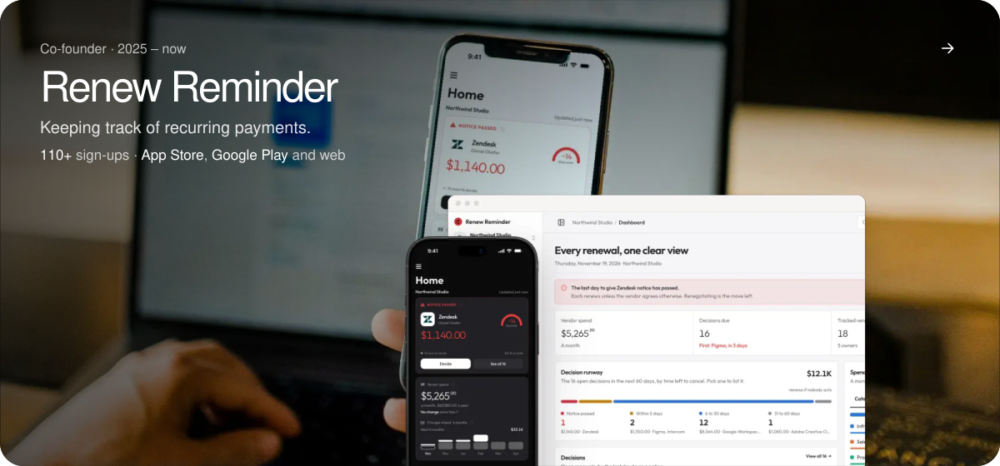
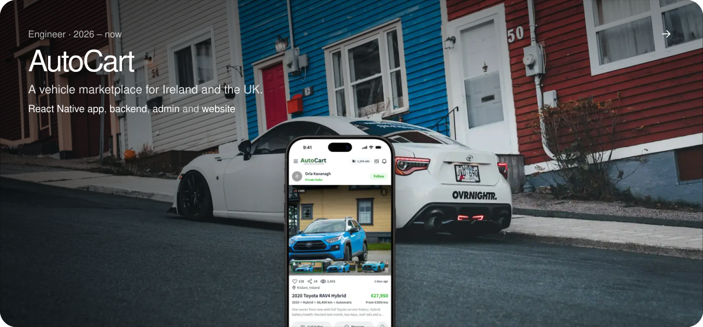
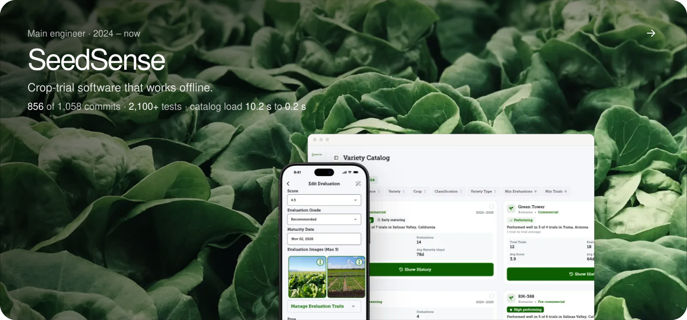

<a href="https://faseehhyder.com"><picture><source media="(prefers-color-scheme: dark)" srcset="./hero-dark.svg"></picture></a>

<p>
  <a href="https://faseehhyder.com"><picture><source media="(prefers-color-scheme: dark)" srcset="./buttons/site-dark.svg"></picture></a>
  <a href="https://faseehhyder.com/work/"><picture><source media="(prefers-color-scheme: dark)" srcset="./buttons/work-dark.svg"></picture></a>
  <a href="https://faseehhyder.com/cv/Faseeh-Hyder-CV.pdf"><picture><source media="(prefers-color-scheme: dark)" srcset="./buttons/cv-dark.svg"></picture></a>
  <a href="https://www.linkedin.com/in/faseehhyder"><picture><source media="(prefers-color-scheme: dark)" srcset="./buttons/linkedin-dark.svg"></picture></a>
</p>

## Products I've built

Most of my code lives in private company and client repositories, so each card opens a case study instead: the screens, the decisions and the trade-offs.

<a href="https://faseehhyder.com/work/renew-reminder/"><picture><source media="(prefers-color-scheme: dark)" srcset="./cards/renew-reminder-dark.svg"></picture></a>

<a href="https://faseehhyder.com/work/autocart/"><picture><source media="(prefers-color-scheme: dark)" srcset="./cards/autocart-dark.svg"></picture></a>

<a href="https://faseehhyder.com/work/seedsense/"><picture><source media="(prefers-color-scheme: dark)" srcset="./cards/seedsense-dark.svg"></picture></a>

## How I work

```ts
const faseeh = {
  builds: ["Flutter", "React Native", "Next.js", "Node.js"],
  data: ["MongoDB", "PostgreSQL", "Redis", "SQLite (offline-first)"],
  ships: ["AWS", "Docker", "GitHub Actions", "Sentry"],
  believes: [
    "Field apps work with no signal, and every record reaches the office.",
    "Measure the slow screen, then fix the query, not the spinner.",
    "Decisions live next to the code: comments, lint rules, tests.",
  ],
};
```

## What clients say

> **“Faseeh is one of the most creative and technical developers I have had the pleasure to have work for our team.”**
> <br><sub>Onda Software Solutions · Upwork · Top Rated, 100% Job Success</sub>

## Open to work

Mobile and full-stack roles, remote or on-site. Based in Pakistan (UTC+5), relocating: **Germany and the EU first**. My degree is recognised in Germany (anabin H+).

**faseehhyder33@gmail.com** · [LinkedIn](https://www.linkedin.com/in/faseehhyder) · [faseehhyder.com](https://faseehhyder.com)
