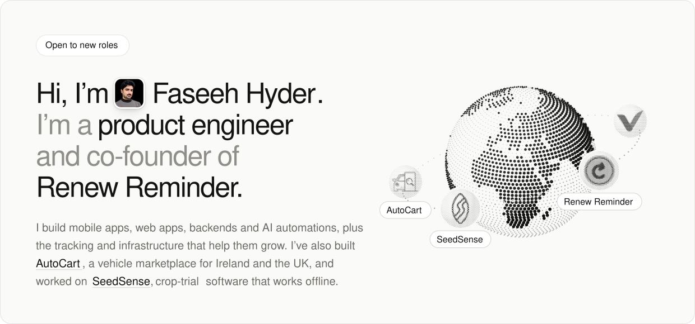

<a href="https://faseehhyder.com"><picture><source media="(prefers-color-scheme: dark)" srcset="./hero-dark.svg"></picture></a>

<p>
  <a href="https://faseehhyder.com"><picture><source media="(prefers-color-scheme: dark)" srcset="./buttons/site-dark.svg"></picture></a>
  <a href="https://faseehhyder.com/work/"><picture><source media="(prefers-color-scheme: dark)" srcset="./buttons/work-dark.svg"></picture></a>
  <a href="https://faseehhyder.com/cv/Faseeh-Hyder-CV.pdf"><picture><source media="(prefers-color-scheme: dark)" srcset="./buttons/cv-dark.svg"></picture></a>
  <a href="https://www.linkedin.com/in/faseehhyder"><picture><source media="(prefers-color-scheme: dark)" srcset="./buttons/linkedin-dark.svg"></picture></a>
</p>

## Products I've built

Most of my code lives in private company and client repositories, so each card opens a case study instead: the screens, the decisions and the trade-offs.

<table>
  <tr>
    <td width="33%" valign="top">
      <a href="https://faseehhyder.com/work/seedsense/"></a>
      <h3>SeedSense</h3>
      <p>Crop-trial software that keeps working offline in the field.</p>
      <p><b>856</b> of 1,058 commits · <b>2,100+</b> tests · catalog <b>10.2 s → 0.2 s</b></p>
    </td>
    <td width="33%" valign="top">
      <a href="https://faseehhyder.com/work/renew-reminder/"></a>
      <h3>Renew Reminder</h3>
      <p>Subscription and spend management I co-founded.</p>
      <p>Live on the <b>App Store</b>, <b>Google Play</b> and the web · <b>110+</b> sign-ups</p>
    </td>
    <td width="33%" valign="top">
      <a href="https://faseehhyder.com/work/autocart/"></a>
      <h3>AutoCart</h3>
      <p>A vehicle marketplace for Ireland and the UK.</p>
      <p>React Native app, backend, admin and website</p>
    </td>
  </tr>
</table>

## How I work

```ts
const faseeh = {
  builds: ["Flutter", "React Native", "Next.js", "Node.js"],
  data: ["MongoDB", "PostgreSQL", "Redis", "SQLite (offline-first)"],
  ships: ["AWS", "Docker", "GitHub Actions", "Sentry"],
  believes: [
    "Field apps work with no signal, and every record reaches the office.",
    "Measure the slow screen, then fix the query, not the spinner.",
    "Decisions live next to the code: comments, lint rules, tests.",
  ],
};
```

## What clients say

> **“Faseeh is one of the most creative and technical developers I have had the pleasure to have work for our team.”**
> <br><sub>Onda Software Solutions · Upwork · Top Rated, 100% Job Success</sub>

## Open to work

Mobile and full-stack roles, remote or on-site. Based in Pakistan (UTC+5), relocating: **Germany and the EU first**. My degree is recognised in Germany (anabin H+).

**faseehhyder33@gmail.com** · [LinkedIn](https://www.linkedin.com/in/faseehhyder) · [faseehhyder.com](https://faseehhyder.com)
